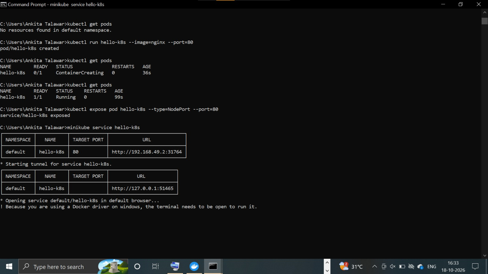
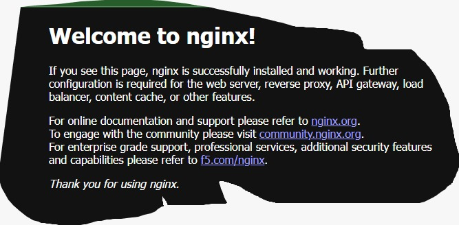

# Lab 01: Hello Pod

## Goal
Run your first app inside Kubernetes and access it.

## Commands used
minikube start
kubectl run hello-k8s --image=nginx --port=80
kubectl get pods
kubectl expose pod hello-k8s --type=NodePort --port=80
minikube service hello-k8s

## Screenshots

## System Internal Details
1. kubectl run sends the request to the API Server.
2. The API Server stores the Pod details in etcd.
3. The Scheduler picks a node to run the Pod.
4. The Kubelet on that node asks the container runtime to pull the nginx image and start the container.
5. kubectl expose creates a NodePort Service that gives the Pod a stable address and opens a port on the node.
6. minikube service opens that NodePort URL in the browser.