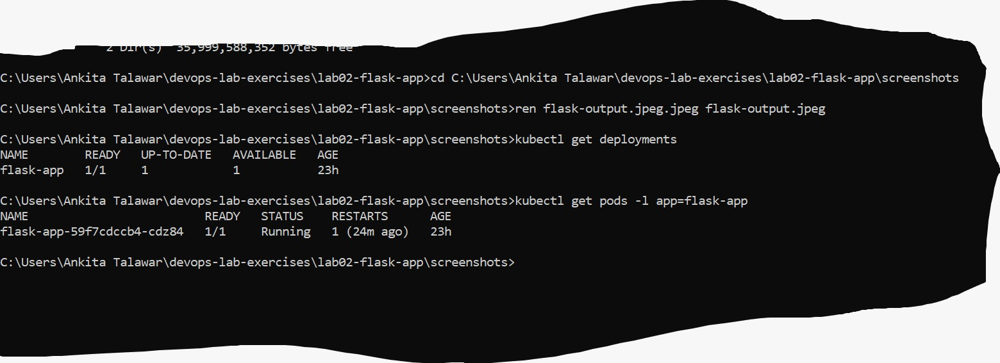
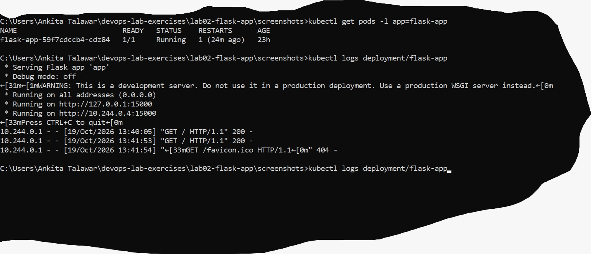
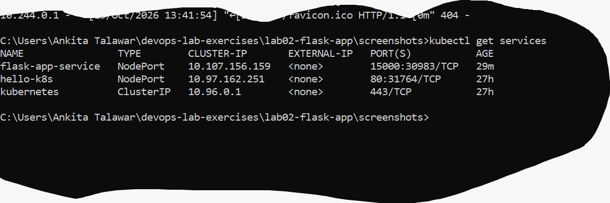
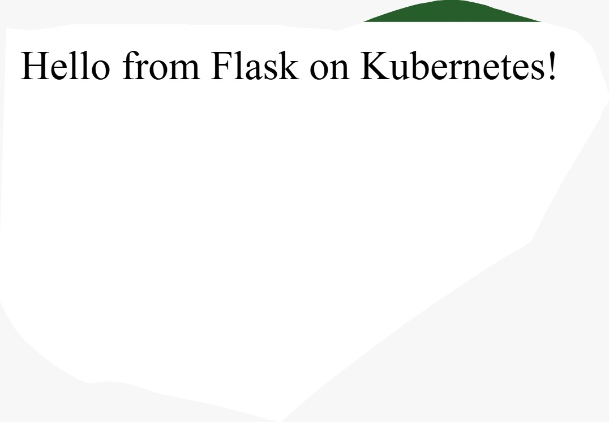

# Lab 02: Deploy a Flask App on Minikube using kubectl and YAML

## Objective
Learn Kubernetes basics by deploying a Python Flask application on a single-node Minikube cluster.

## Files
- app.py: Flask application (listens on port 15000)
- Dockerfile: builds the Flask app image
- flask-deployment.yaml: Deployment and NodePort Service

## Commands used
minikube start
docker build -t flask-app:latest .
minikube image load flask-app:latest
kubectl apply -f flask-deployment.yaml
kubectl get deployments
kubectl get pods -l app=flask-app
kubectl describe deployment flask-app
kubectl logs deployment/flask-app
kubectl get services
minikube service flask-app-service --url
curl http://127.0.0.1:54660

## Screenshots

### Deployment and Pod

### Application logs

### Services

### Flask app output

## What I learned
- A Deployment keeps the desired number of pods running.
- imagePullPolicy: Never makes Kubernetes use the locally loaded image.
- A pod's port is not reachable from outside by default. A NodePort Service exposes it.
- port is the Service port, and targetPort is the container port.
- Request flow: client -> Service (15000) -> container (15000).