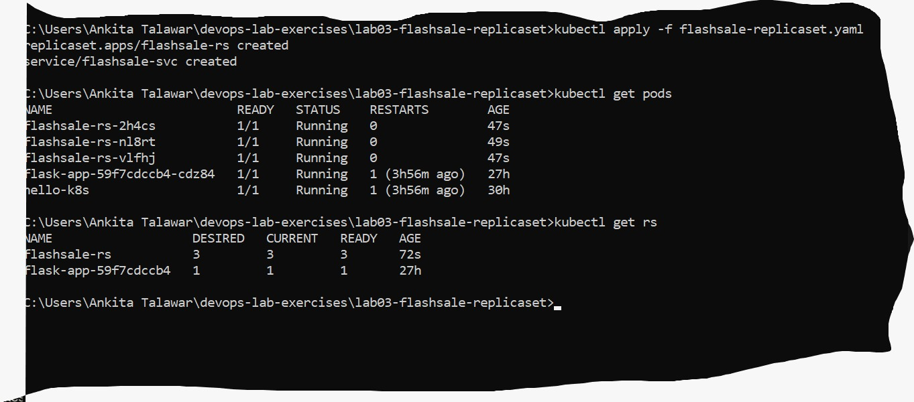
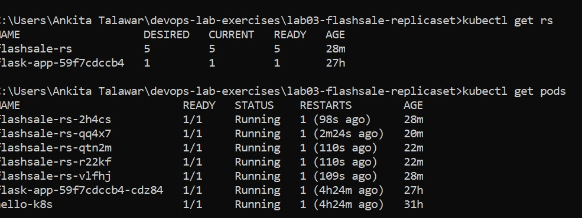
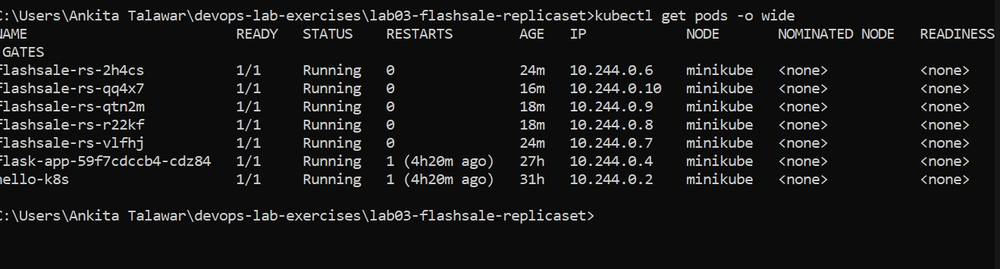
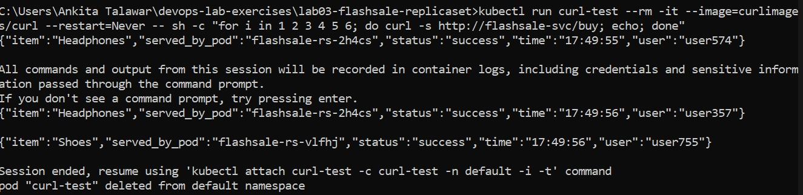

# Lab 03: Scaling a Flask App on a Single Node using ReplicaSets

## Objective
- Understand ReplicaSets and Pods
- Scale the Flask (Flash Sale) app
- Observe pod distribution

## Files
- app.py: Flash Sale Flask app (/, /buy, /health)
- Dockerfile: builds the flashsale:1.0 image (gunicorn on port 5000)
- flashsale-replicaset.yaml: ReplicaSet (3 replicas) and ClusterIP Service

## Commands used
minikube start
docker build -t flashsale:1.0 .
minikube image load flashsale:1.0
kubectl apply -f flashsale-replicaset.yaml
kubectl get pods
kubectl get rs
kubectl scale rs flashsale-rs --replicas=5
kubectl delete pod <pod-name>
kubectl get pods -o wide
kubectl run curl-test --rm -it --image=curlimages/curl --restart=Never -- sh -c "for i in 1 2 3 4 5 6; do curl -s http://flashsale-svc/buy; echo; done"

## Screenshots

### 3 replicas running

### Scaled to 5 replicas

### Pod distribution across nodes

### Load spread across pods

- Scaling up or down is one command (kubectl scale).
- If a pod is deleted or fails, the ReplicaSet replaces it automatically.
- A Service spreads requests across the pods, as seen by the different served_by_pod names.