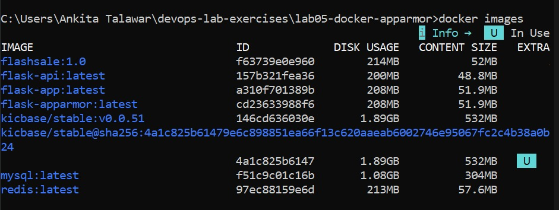
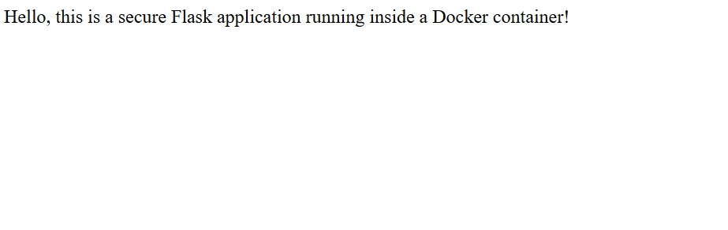
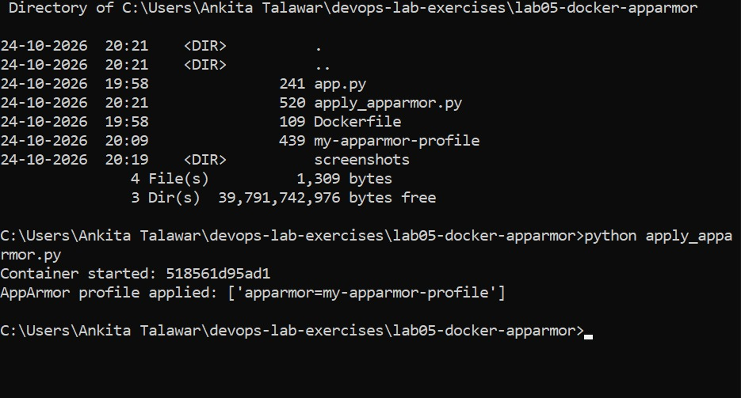
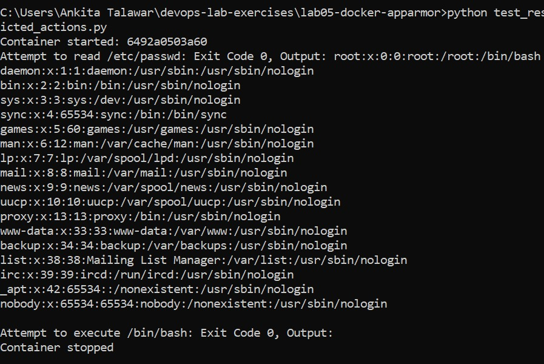

# Lab 05: Docker Security with AppArmor and Python

## Objective
Secure a Docker container with an AppArmor profile, apply it with the Docker SDK for Python, and test restricted actions.

## Files
- app.py: Flask application (port 5000)
- Dockerfile: builds the flask-apparmor image
- my-apparmor-profile: AppArmor profile (to be loaded at /etc/apparmor.d/ on a Linux host)
- apply_apparmor.py: builds the image and runs it with the profile using the Docker SDK
- test_restricted_actions.py: tests reading /etc/passwd and running /bin/bash

## Commands used
docker build -t flask-apparmor .
docker run -d --name flask-secure --security-opt "apparmor=my-apparmor-profile" -p 5000:5000 flask-apparmor
docker inspect flask-secure --format "{{.HostConfig.SecurityOpt}}"
pip install docker
python apply_apparmor.py
python test_restricted_actions.py

## Screenshots

### Image build

### Container running with the profile option

### Flask app in browser

### apply_apparmor.py output

### test_restricted_actions.py output

## Important note about this environment
This lab was run on Windows with Docker Desktop. AppArmor is a Linux kernel feature, and the Docker Desktop Linux VM does not have it enabled. So apparmor_parser could not be used to load the profile, and Docker accepted the apparmor=my-apparmor-profile option but did not enforce it.

Result: apply_apparmor.py printed the expected output (AppArmor profile applied: ['apparmor=my-apparmor-profile']), but test_restricted_actions.py returned Exit Code 0 for both cat /etc/passwd and /bin/bash, instead of the expected 1 and 126. On a Linux host with AppArmor, these steps would be run first:
sudo cp my-apparmor-profile /etc/apparmor.d/my-apparmor-profile
sudo apparmor_parser -r /etc/apparmor.d/my-apparmor-profile
and the restricted actions would then be denied.

I also corrected the sheet's profile: it was declared as /usr/bin/python3 { ... }, which does not match the name my-apparmor-profile used by Docker, so it now starts with "profile my-apparmor-profile flags=(attach_disconnected,mediate_deleted)". The broad deny rules on /etc/** were narrowed, since Python cannot start without reading some files.

## Questions and Answers

Q1. What is the purpose of using AppArmor with Docker containers?
A. AppArmor is a Linux security module that limits what a container can do, so a compromised container cannot harm the host or access things it should not.

Q2. How do AppArmor profiles help secure a Docker container?
A. A profile lists the files, capabilities and network actions a process may use. Anything not allowed, or explicitly denied, is blocked by the kernel.

Q3. Why is it important to restrict access to sensitive directories such as /etc/ and /var/?
A. They hold system configuration, credentials and logs. Restricting them prevents data theft, tampering and privilege escalation if the app is compromised.

Q4. What other capabilities can you restrict using AppArmor profiles?
A. File read/write/execute, network access (inet, raw sockets), Linux capabilities (such as sys_admin, net_admin), mounting filesystems, ptrace, signals and executing other programs.

Q5. How can you verify if an AppArmor profile is successfully applied to a Docker container?
A. Use docker inspect to check HostConfig.SecurityOpt, run sudo aa-status on the host to see the loaded profile, and test restricted actions to confirm they are denied.s