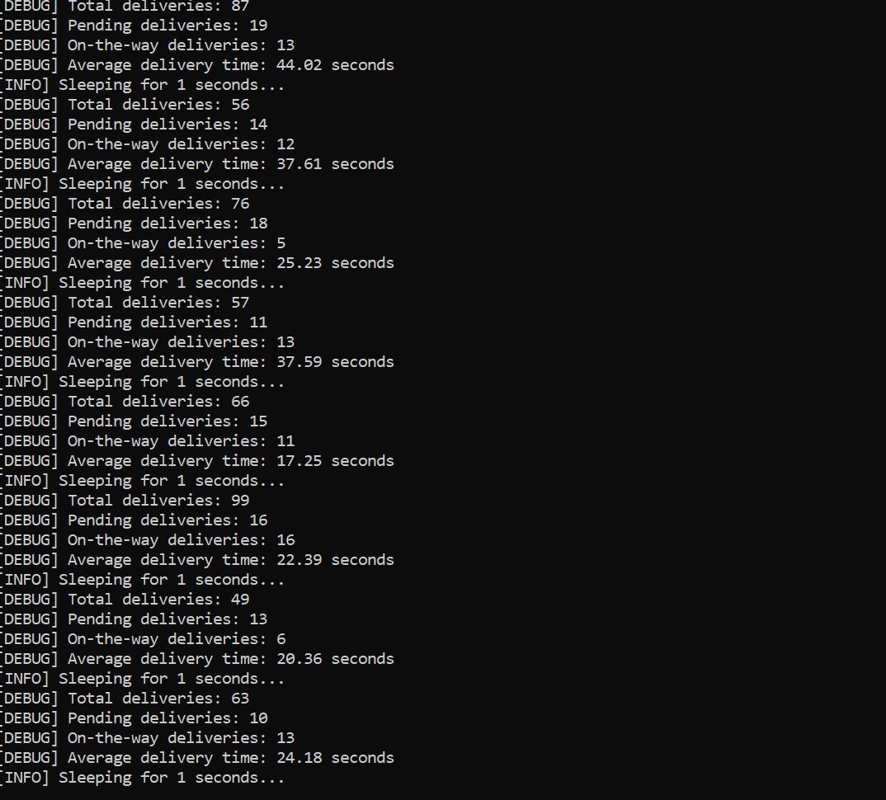
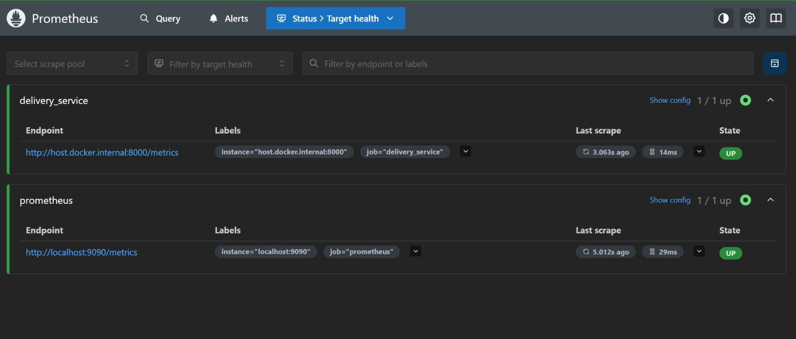
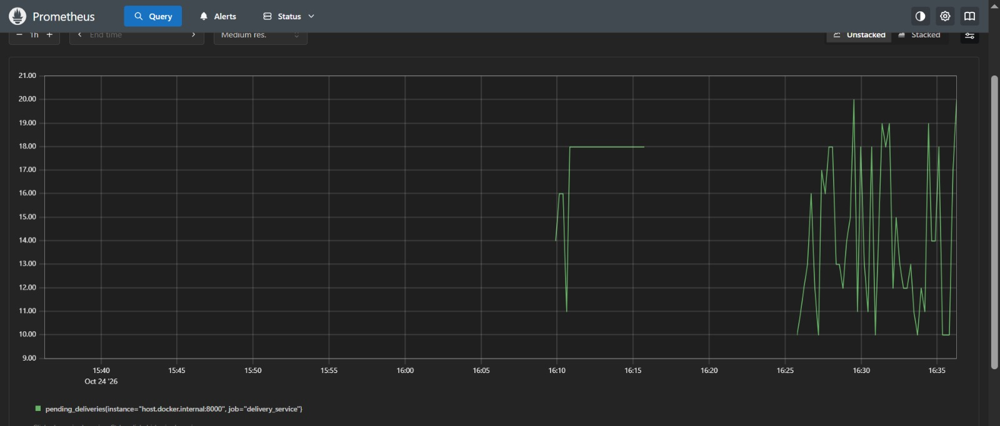
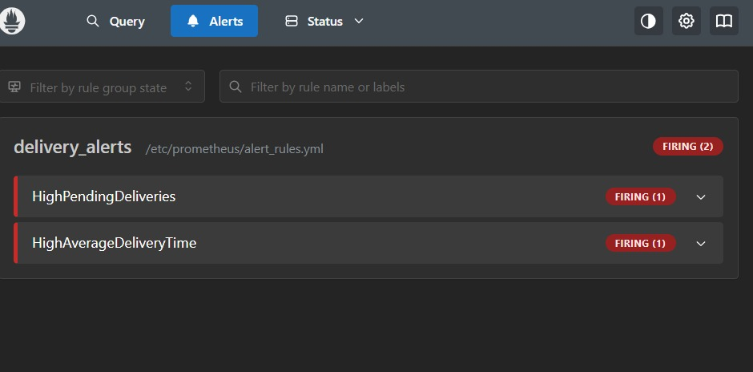
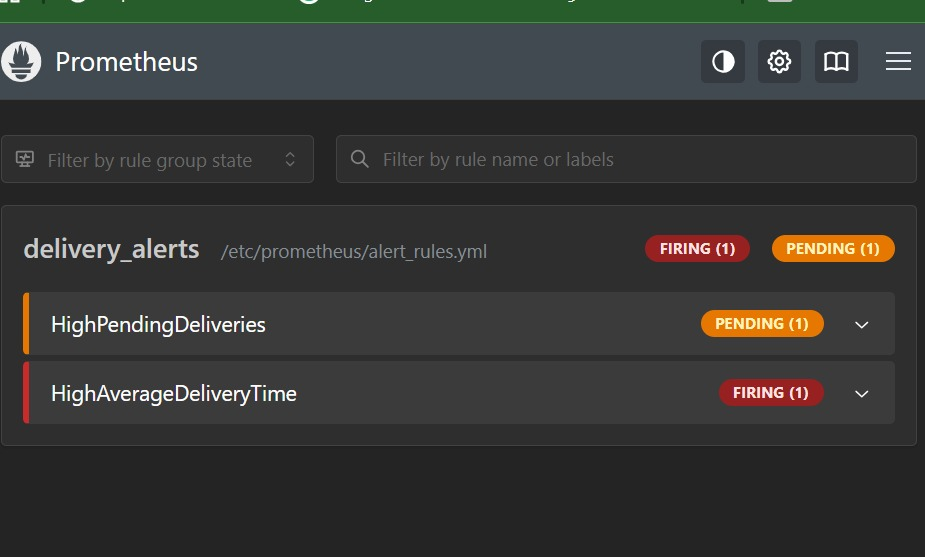
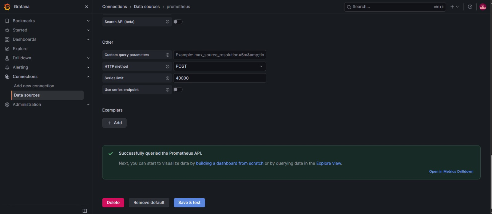
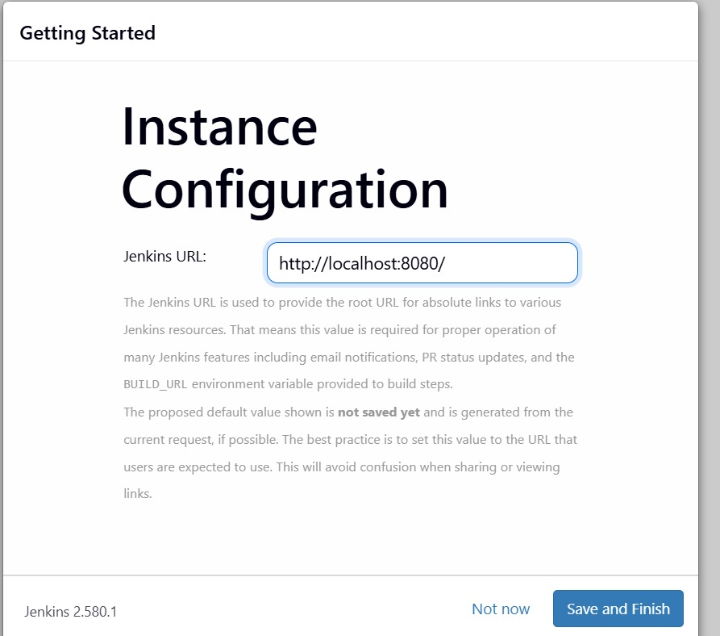
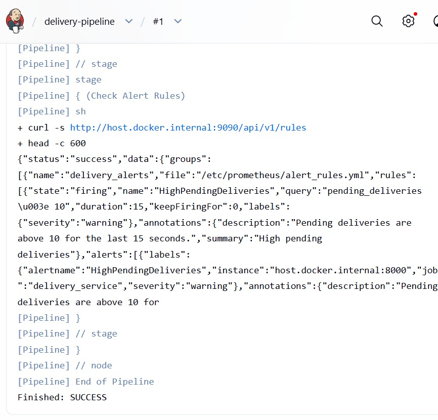

# Lab 06: Real-Time Operations Monitoring and Alerting

## Objective
Simulate delivery metrics with Python, scrape them with Prometheus, define alert rules, and automate checks with a Jenkins pipeline.

## Files
- delivery_metrics.py: simulates delivery metrics and exposes them on port 8000
- prometheus.yml: Prometheus scrape configuration
- alert_rules.yml: alert rules (HighPendingDeliveries, HighAverageDeliveryTime)
- Jenkinsfile: pipeline that checks the metrics app, Prometheus and alert rules

## Commands used
pip install prometheus-client
python delivery_metrics.py
docker run -d --name prometheus -p 9090:9090 -v "%cd%\prometheus.yml:/etc/prometheus/prometheus.yml" -v "%cd%\alert_rules.yml:/etc/prometheus/alert_rules.yml" prom/prometheus
docker run -d --name grafana -p 3000:3000 grafana/grafana
docker run -d -p 8080:8080 -p 50000:50000 --name jenkins -v jenkins_home:/var/jenkins_home jenkins/jenkins:lts

## Screenshots

### Python script running

### Prometheus targets

### Prometheus query (pending_deliveries)

### Alerts (normal state)

### Alert firing (pending_deliveries raised to 50-100)

### Grafana data source

### Jenkins home

### Jenkins pipeline console output

## Changes made for Windows
- Prometheus runs with -p 9090:9090 instead of --network=host, which Docker Desktop on Windows does not support.
- The scrape target is host.docker.internal:8000 instead of 172.17.0.1:8000.
- The alert file name is alert_rules.yml everywhere (the sheet had both alerts_rules.yml and alert_rules.yml).
- The Jenkins pipeline was simplified: the Jenkins container has no Docker inside it and the sheet gives no Dockerfile for the build stage, so the pipeline checks the metrics app, Prometheus and the alert rules with curl.

## Note
The Grafana dashboard panels were not completed in this lab. Grafana was started, the admin login was reset and the Prometheus data source was added, but the four dashboard panels were skipped.

## What I learned
- Prometheus scrapes the /metrics endpoint exposed by the Python prometheus_client library.
- A Gauge holds values that go up and down; a Summary tracks sum and count, so average = sum / count.
- An alert fires when its expression stays true for the "for" duration.
- Jenkins can automate checks of the monitoring stack as a pipeline.