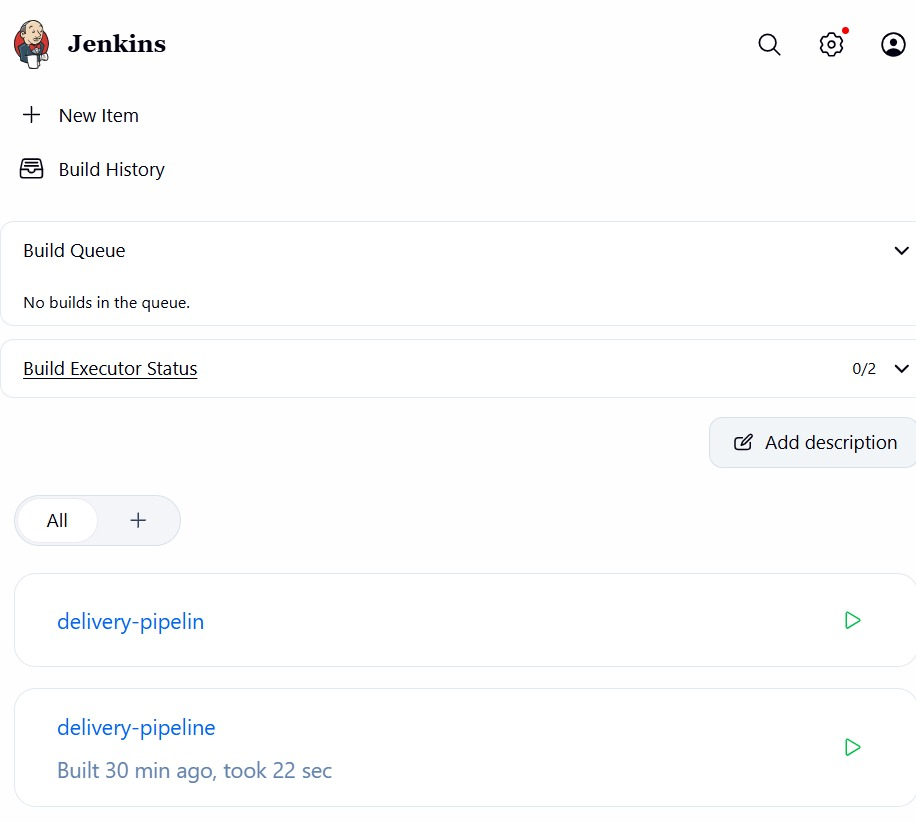

# Lab 07: Introduction to Continuous Integration (CI) and Jenkins Installation

## What is Continuous Integration (CI)?
CI is a development practice where developers frequently merge their code changes into a shared repository. Each merge triggers an automated build and tests, so errors are found early.

## Key features of CI
- Frequent code integration: commits several times a day
- Automated builds: every commit triggers a build
- Automated testing: tests run as part of the build
- Immediate feedback: developers learn quickly if something broke

## Benefits of CI
- Early bug detection, which lowers the cost of fixes
- Better collaboration on one shared codebase
- Faster development cycles through automation
- Higher code quality and fewer regressions

## How CI works
1. Developer pushes code to version control (e.g. Git)
2. The CI server (e.g. Jenkins) detects the change and triggers a build
3. The code is compiled and dependencies are resolved
4. Automated tests run
5. Results (success or failure) are reported back to developers

## Examples of CI tools
- GitLab CI/CD: built into GitLab, YAML pipelines
- CircleCI: cloud-based, container-based execution
- Travis CI: popular for open-source projects
- Bamboo: Atlassian tool, integrates with JIRA and Bitbucket
- TeamCity: JetBrains server for enterprise setups
- Azure DevOps Pipelines: Microsoft, integrates with Azure
- GitHub Actions: workflows directly in GitHub repositories
- Spinnaker: continuous delivery for cloud-native apps
- Buildkite: cloud management with self-hosted agents
- Drone: lightweight, container-based pipelines

## Introduction to Jenkins
Jenkins is an open-source automation server used to build, test and deploy software, enabling Continuous Integration and Continuous Delivery (CD).

Why use Jenkins: automation of repetitive tasks, continuous integration, extensibility through plugins, and scalability with distributed builds.

Key concepts:
- Job/Project: a task Jenkins runs
- Build: compiling and packaging code
- Pipeline: a series of steps to build, test and deploy
- Plugins: extend Jenkins (Git, Docker, etc.)
- Nodes: machines that run jobs (controller/agent)

## Installing Jenkins using Docker
Commands:
docker run -d --name jenkins -p 8080:8080 -p 50000:50000 -v jenkins_home:/var/jenkins_home jenkins/jenkins:lts
docker ps -a
docker exec jenkins cat /var/jenkins_home/secrets/initialAdminPassword

Then open http://localhost:8080, paste the initial admin password, install the suggested plugins and create the first admin user.

Jenkins was already installed in Lab 06, so here it was restarted with: docker start jenkins

## Screenshots

### Jenkins container running

### Jenkins landing page

## What I learned
- CI catches integration problems early by building and testing every commit.
- Jenkins is a CI server that can run builds and pipelines automatically.
- Docker makes installing Jenkins a single command.