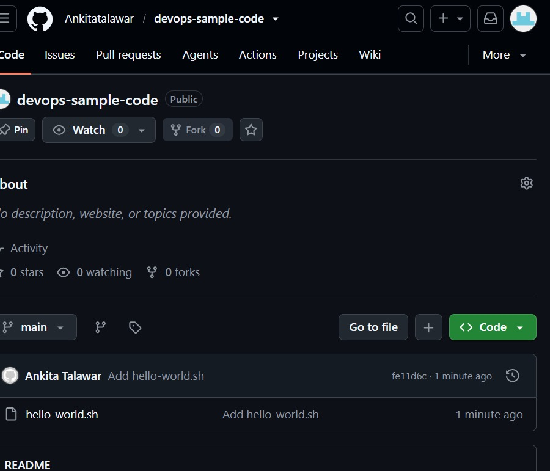
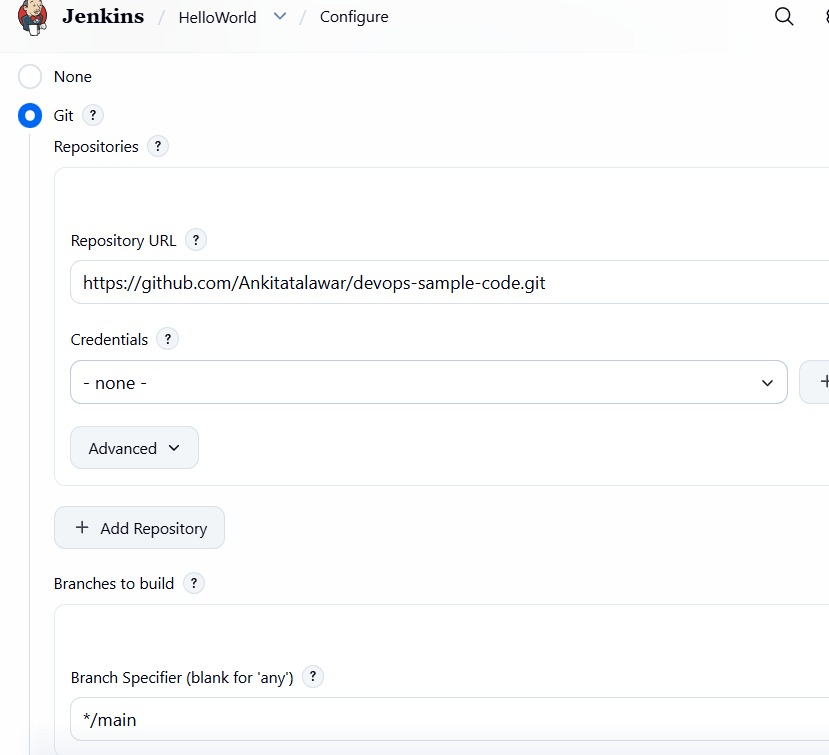
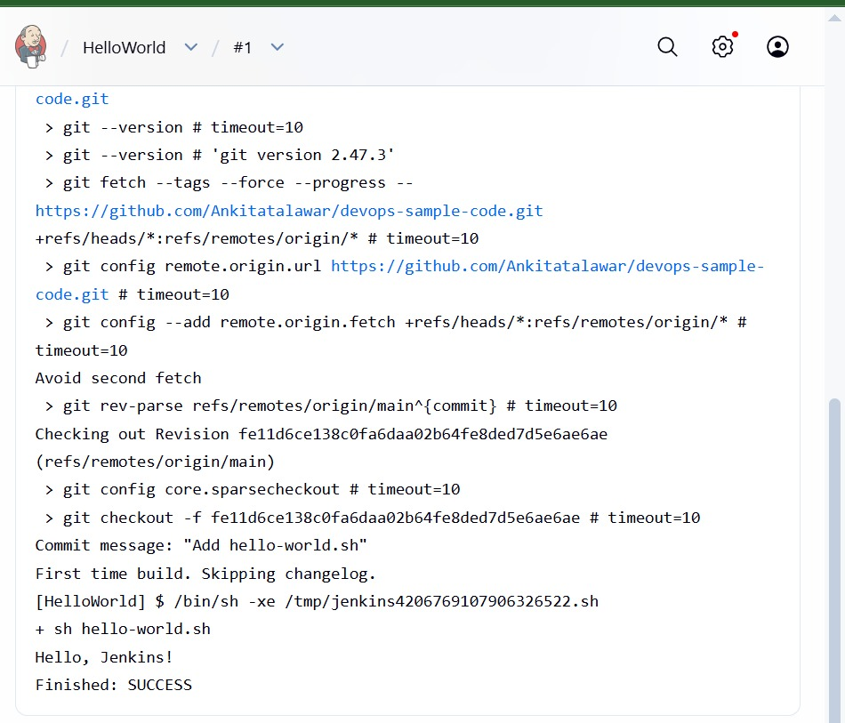

# Lab 08: Creating a "Hello World" Jenkins Job

## Objective
Put a shell script on GitHub and create a Jenkins Freestyle job that pulls it from the repository and runs it.

## Script repository
https://github.com/Ankitatalawar/devops-sample-code

hello-world.sh:
#!/bin/bash
echo "Hello, Jenkins!"

## Steps followed
1. Created a public GitHub repository named devops-sample-code.
2. Created hello-world.sh locally, committed it and pushed it to the main branch.
3. Started Jenkins in Docker (docker start jenkins) and logged in at http://localhost:8080.
4. Created a Freestyle project named HelloWorld.
5. Set Source Code Management to Git with the repository URL above and Branch Specifier */main.
6. Added an "Execute shell" build step: sh hello-world.sh
7. Saved the job and clicked Build Now.
8. Opened the build and checked Console Output.

## Commands used
git init
git add hello-world.sh
git commit -m "Add hello-world.sh"
git branch -M main
git remote add origin https://github.com/Ankitatalawar/devops-sample-code.git
git push -u origin main
docker start jenkins

## Screenshots

### Script on GitHub

### Job configuration

### Console output

## Changes made for Windows
- touch and chmod +x are Linux commands, so the file was created in Notepad. Jenkins runs it with sh, so it does not need execute permission.
- The branch is main (the sheet shows master in places), so the Branch Specifier was set to */main.

## What I learned
- A Jenkins Freestyle job can pull code from a Git repository and run it.
- The Branch Specifier must match the real branch name.
- The Console Output shows the logs and the final result (SUCCESS or FAILURE).