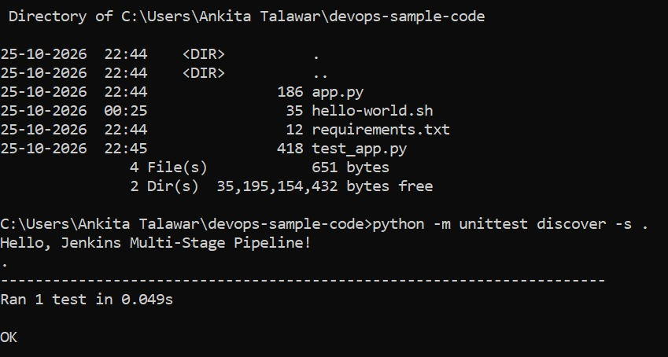
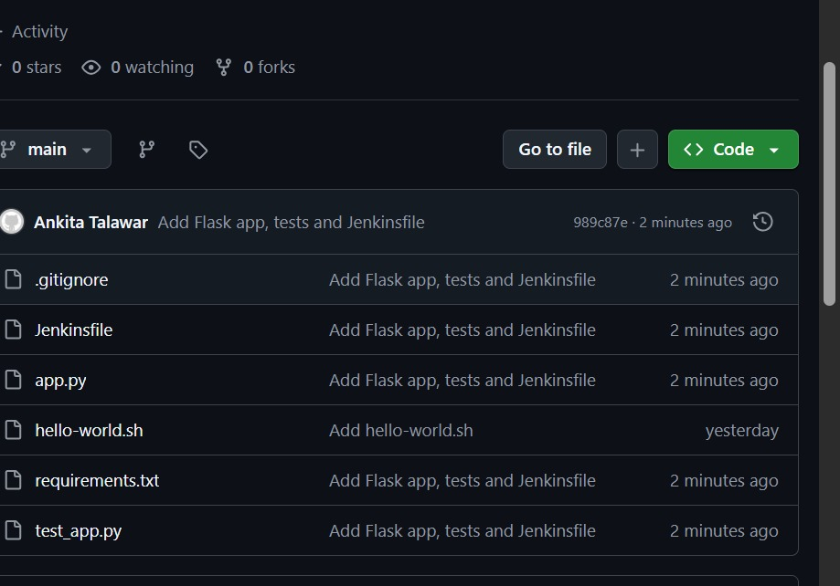
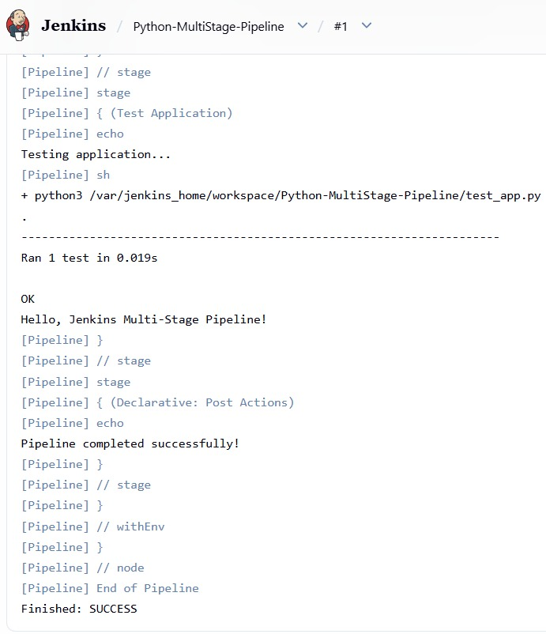

# Lab 09: Jenkins Multi-Stage Pipeline (Deploying a Python Application)

## Objective
Create a Jenkins Pipeline with multiple stages (Build, Test, Deploy, Run Application, Test Application) for a Python Flask application.

## Code repository
https://github.com/Ankitatalawar/devops-sample-code

Files in the repository:
- app.py: Flask application
- requirements.txt: dependencies (flask==2.1.2)
- test_app.py: unit test for the home page
- Jenkinsfile: the multi-stage pipeline

## Pipeline stages
1. Build: installs dependencies (echo step)
2. Test: python3 -m unittest discover -s .
3. Deploy: copies app.py to a python-app-deploy folder in the workspace
4. Run Application: starts the app in the background with nohup
5. Test Application: runs test_app.py again
Post actions print a success or failure message.

## Steps followed
1. Created app.py, requirements.txt and test_app.py and ran the test locally.
2. Created the Jenkinsfile and pushed everything to GitHub.
3. Installed Python inside the Jenkins container:
   docker exec -u root jenkins apt-get update
   docker exec -u root jenkins apt-get install -y python3 python3-flask
4. Created a Pipeline job named Python-MultiStage-Pipeline using "Pipeline script from SCM" with Git, branch */main and script path Jenkinsfile.
5. Clicked Build Now and checked the Console Output.

## Screenshots

### Local test

### Code on GitHub

### Job configuration

### Console output

## Changes made for Windows
- Files were created in Notepad instead of with Linux commands.
- The existing devops-sample-code repository was reused, so no new git remote was added.
- The Branch Specifier is */main because the branch is called main.
- Python had to be installed inside the Jenkins container because the Jenkins image does not include it.

## What I learned
- A Jenkins pipeline can be defined as code in a Jenkinsfile stored in Git.
- Stages run in order, and a failure in one stage stops the pipeline.
- The Jenkins container needs its own Python and dependencies to run Python tests.